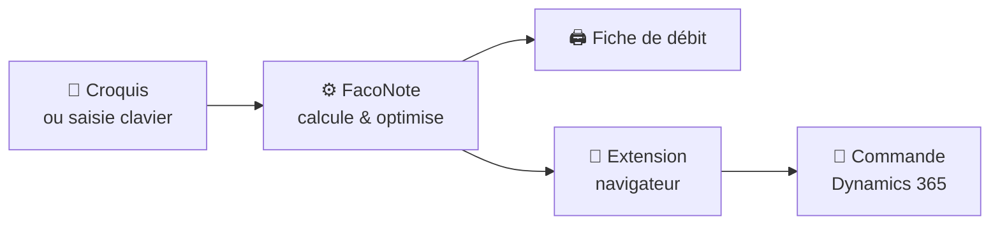

# 🛠️ FacoNote

### Du croquis de chantier à la fiche de débit, en quelques secondes.

**L'assistant des ateliers de façonnage zinc & alu pour la toiture et le bardage.**
Encoder, calculer, optimiser la refente, imprimer : tout au même endroit.

 

 

---

## 💡 Pourquoi FacoNote ?

À l'atelier, une commande arrive souvent sous forme de croquis griffonné : des développés, des longueurs, des quantités, plusieurs matières mélangées.
Il faut tout ressaisir, calculer les surfaces et les poids, choisir les bonnes bobines, limiter les chutes… puis tout recopier dans l'ERP.

**FacoNote fait ce travail à ta place.** Tu tapes (ou tu photographies), il calcule, il optimise, il imprime.

---

## ✨ Ce qu'il sait faire

<table>
<tr>
<td width="50%" valign="top">

### ⚡ Encodage éclair
Trois cases : **quantité · développé · longueur**. `Entrée`, et la ligne est ajoutée.
Pensé pour enchaîner les pièces au clavier, sans jamais lâcher le pavé numérique.

</td>
<td width="50%" valign="top">

### 📸 Croquis → données
Prends le croquis en photo **depuis ton téléphone**, l'IA le lit et pré-remplit les pièces.
Tu vérifies, tu valides, c'est encodé.

</td>
</tr>
<tr>
<td width="50%" valign="top">

### 🧮 Calculs instantanés
Surfaces, poids, totaux par matière et par finition, regroupement par bornes de développé.
Une calculette d'atelier est même intégrée, formules comprises.

</td>
<td width="50%" valign="top">

### ✂️ Refente optimisée
Calepinage des feuilles mères sur les **largeurs de bobines réellement disponibles**,
zinc et alu séparés, chutes et rendement affichés d'un coup d'œil.

</td>
</tr>
<tr>
<td width="50%" valign="top">

### 🧵 Calculateur bobines
Même logique rapide pour les saisies bobines, avec des messages d'erreur
qui pointent la case exacte à corriger.

</td>
<td width="50%" valign="top">

### 🖨️ Fiche de débit A4
Une fiche propre, prête à imprimer ou à exporter en PDF, à poser directement sur l'établi.

</td>
</tr>
</table>

---

## 🔌 Branché sur Dynamics 365

FacoNote est livré avec sa propre **extension navigateur**.
Un clic, et les longueurs par borne partent directement dans la commande **Dynamics 365 Finance & Operations**, matière par matière.
Fini la double saisie.

---

## 🎨 Matières gérées

| | Matière | Largeurs de bobines (mm) |
|:-:|---|---|
| 🩶 | **Zinc** (toutes finitions) | `600` · `670` · `750` · `1000` |
| ⬛ | **Alu RAL 9005** & **RAL 7039** | `650` · `1000` |
| ⬜ | **Alu RAL 9010** & **RAL 7016** | `1000` |
| 🔘 | **Alu Brut 1.5** | `1000` |

---

## 🧠 Sous le capot

- **Un seul cerveau** : tous les calculs métier vivent côté serveur, testés un par un. L'interface ne fait qu'afficher. Résultat : les mêmes chiffres partout, toujours.
- **Fiable** : plus de 100 tests automatiques et un typage strict vérifiés avant chaque mise en ligne.
- **Sécurisé** : espace administrateur protégé, aucun mot de passe stocké en clair.
- **Fait pour l'atelier** : lisible sur tablette comme sur PC, contraste élevé, rapide même sur une connexion moyenne.

 

**Conçu par un atelier, pour les ateliers.** 🏗️

Les détails techniques sont dans <a href="backend/README.md">backend/README.md</a> et <a href="frontend/README.md">frontend/README.md</a>.

