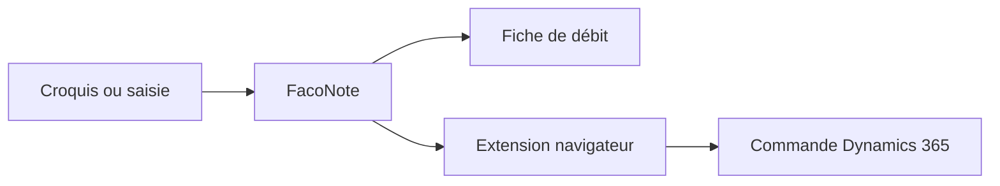

# FacoNote

**Du croquis de chantier à la fiche de débit.**

Un outil web pour les ateliers de façonnage zinc et alu, en toiture et en bardage.

 

 

 

On encode les pièces d'une commande, FacoNote calcule les surfaces et les poids, prépare la refente des bobines et sort une fiche de débit à imprimer. Les longueurs peuvent ensuite partir directement dans Dynamics 365.

<table>
<tr>
<td width="50%" valign="top">

### ⚡ Encodage au clavier
Une pièce, c'est trois champs : quantité, développé, longueur. Entrée ajoute la ligne, et on enchaîne toute la commande sans toucher la souris.

</td>
<td width="50%" valign="top">

### 📸 Photo du croquis
Le croquis papier se prend en photo avec un téléphone. FacoNote le lit avec Gemini et pré-remplit les pièces, qu'il reste à vérifier.

</td>
</tr>
<tr>
<td width="50%" valign="top">

### 🧮 Calculs
Surfaces, poids et totaux par matière et par finition, regroupés par bornes de développé. Il y a aussi une calculette d'atelier qui accepte les formules.

</td>
<td width="50%" valign="top">

### ✂️ Refente des bobines
Les pièces sont réparties sur les largeurs de bobines de l'atelier, zinc et alu séparés, avec les chutes et le rendement affichés.

</td>
</tr>
<tr>
<td width="50%" valign="top">

### 🧵 Bobines
Un écran dédié aux saisies bobines, sur le même principe que les pièces.

</td>
<td width="50%" valign="top">

### 🖨️ Fiche de débit
Une fiche A4 à imprimer ou à enregistrer en PDF, prête pour l'atelier.

</td>
</tr>
</table>

## Envoi vers Dynamics 365

Le dossier `extension-d365` contient une extension Chrome et Edge. Elle reprend les longueurs par borne calculées dans FacoNote et les reporte dans la commande Dynamics 365 Finance & Operations, matière par matière. Plus besoin de tout ressaisir dans l'ERP.

## Matières et largeurs de bobines

| Matière | Largeurs (mm) |
|---|---|
| Zinc, toutes finitions | `600` · `670` · `750` · `1000` |
| Alu RAL 9005 et RAL 7039 | `650` · `1000` |
| Alu RAL 9010 et RAL 7016 | `1000` |
| Alu brut 1.5 | `1000` |

## Technique

L'interface est écrite en React et TypeScript, le serveur en Python avec FastAPI. Tous les calculs se font sur le serveur et sont couverts par des tests. Le détail est dans [backend/README.md](backend/README.md) et [frontend/README.md](frontend/README.md).
